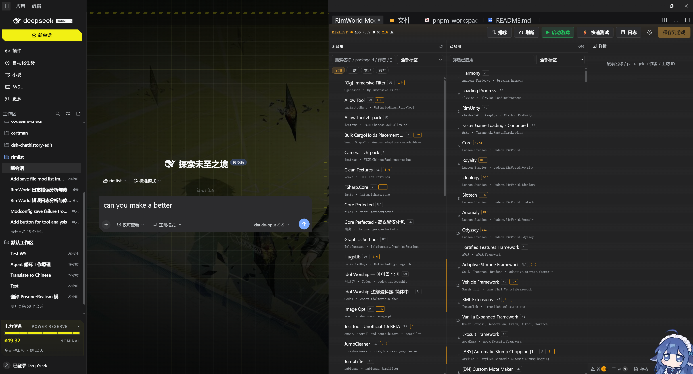

# dsh-rimlist

**English** | [简体中文](README.zh-CN.md)

> **AI-generated notice**: All code, tests, tutorials and documentation in this project were written by AI, using **claude-opus-5-5** and **DeepSeek 4.1 Flash**. The author provided the requirements, testing and review. Evaluate it yourself before relying on it; it backs up `ModsConfig.xml` before every write, but keep your own backups too.

A RimWorld mod manager inside DeepSeek Harness (DSH). It is a RimSort-style two-column load-order manager with rule-database sorting, diagnostics, game-log analysis, reading mod lists from save files, mod changelogs / backup and rollback / installing from Git, and 32 AI tools. Mod lists can be shared with other players.

Open it from the **RimWorld Mods tab in the DSH right sidebar**.



## Interface

| Area | Contents |
| --- | --- |
| Top bar | ⇅ Sort · ↻ Refresh · ▶ Launch game · ⚡ Quick test · 📄 Log · ⚙ Settings · Save to game |
| Left column | Inactive mods (search; filter by All / Workshop / Local / Official, and by tag) |
| Middle column | Active mods, i.e. the current load order |
| Right column | Details · Diagnostics · Lists · Rules · Versions · Saves (with count badges), plus Log and Settings. Only the current tab shows its label; the others show an icon |

When the sidebar is narrow it switches to a single column; use the Inactive / Active / Panel buttons at the top to switch views.

## Features

### Load order
- **Scan**: Core / DLC, the local `Mods/` folder and the Steam Workshop (including multiple Steam libraries).
- **Drag and drop**:
  - Drag between the two columns; multi-select with Ctrl / Shift.
  - Move to top / bottom. Keys: `↑`/`↓` select (`Shift` extends, `Home`/`End`/`PageUp`/`PageDown` jump), `Alt+↑`/`Alt+↓` move an active mod, `Delete` deactivates, `Enter` activates, `Ctrl+S` saves.
- **Details**: large preview (click to zoom), author, version, dependencies, rules, workshop link, personal note.

### Sorting
Click "⇅ Sort" once. Constraint sources, from highest to lowest priority:

**Forced (forceLoad + official DLC order) > user rules > About.xml > community rules > modDependencies > tie-break**

The tie-break decides how mods with no constraint between them are ordered. Choose it in ⚙ Settings → Sorting:

| Mode | Description |
| --- | --- |
| By name (default) | Priority-aware sort, ties broken alphabetically (natural number order: Mod 9 before Mod 10) |
| Keep current order | Only moves mods that have to move |
| RimSort compatible | A port of RimSort's Topological algorithm: tiers (Core/Harmony → 13 built-in frameworks → regular → loadBottom), level-by-level toposort per tier, ties by name |

On a rule conflict (a cycle) RimSort refuses to sort; here the lowest-priority rule in the cycle is dropped and reported in diagnostics.

### Rule databases (the same five as RimSort, configurable sources)
Each database can be: none / GitHub / any URL (raw file, .gz or repo .zip) / local file. A local file can point straight at an existing RimSort data folder (e.g. `~/.local/share/RimSort/dbs/…`).

- [RimSort/Community-Rules-Database](https://github.com/RimSort/Community-Rules-Database): loadAfter / loadBefore / loadTop / loadBottom / incompatibleWith
- [RimSort/Steam-Workshop-Database](https://github.com/RimSort/Steam-Workshop-Database): dependencies, names and versions declared on workshop pages
- [emipa606/NoVersionWarning](https://github.com/emipa606/NoVersionWarning): mods that do not list the current version but are known to work
- [emipa606/UseThisInstead](https://github.com/emipa606/UseThisInstead): replacements for abandoned mods, one click from diagnostics
- [bukforks/rimworld-versions](https://github.com/bukforks/rimworld-versions): RimWorld version history

Downloads are cached in `~/.dsh/rimlist/db/` and refreshed every 7 days by default; the cache is used when offline.

### User rules (override the community database)
The community database is often missing or wrong for new and niche mods. Fill the gaps here:
- **Pin current order**: multi-select several active mods and save their current relative order as rules; future sorts keep it.
- **Ignore incompatibility**: dismiss a false "incompatible" report with one click (stored as an `ignoreIncompatible` rule).
- Add loadAfter / loadBefore / incompatibleWith / loadTop / loadBottom by hand.
- Import / export RimSort-format `userRules.json`.
- Every rule shows its source (user / community / About.xml); you are warned when a user rule overrides a community rule.

### Diagnostics
- Missing or inactive dependencies: activate with one click, or jump to Steam to subscribe.
- Version mismatches (consulting NoVersionWarning), incompatibilities, order violations, duplicate installs.
- Suggests a replacement when one exists (UseThisInstead).

### Lists (share with other players)
- Save named lists. Each mod remembers where it came from (workshop id, or git URL + branch).
- Import by paste, URL (GitHub raw / Gist / rentry / pastebin) or file. Formats: rimlist JSON, `ModsConfig.xml`, plain packageIds, Markdown tables, workshop links and RimSort text exports.
- Export as rimlist JSON, `ModsConfig.xml` (RimSort / RimPy compatible), packageIds or Markdown.
- Compare with the current order and apply by replacing or merging; fetch missing mods in one step (git mods are cloned, workshop mods open their subscribe page).

### Saves
- The Saves tab lists `*.rws` save files (name, date, game version, mod count).
- Reads the mod list stored in a save, marks mods that are not installed, and diffs it against the current load order.
- Import a save's mod list as a named list, then apply it or fetch the missing mods. Save files are only read, never modified.

### Launching the game
- Click ▶ to launch; the load order is saved first by default. "⚡ Quick test" adds `-quicktest`, which skips the main menu and generates a small map, a fast way to check that a mod list loads.
- Choose the launch method in ⚙ Settings → Launch:
  - **Steam**: `steam://rungameid/294100`, or set the Steam path to pass arguments via `-applaunch`.
  - **Direct**: finds `RimWorldLinux` / `RimWorldWin64.exe` / `RimWorldMac.app` automatically.
  - **Custom**: any command, e.g. flatpak, Proton or a script.
- Add extra game arguments and preview the exact command; check whether the game is running and close it.

### Game log
- 📄 Log opens a `Player.log` viewer that refreshes while the game writes to it (checked every 3 seconds).
- Unity noise is filtered out; identical errors collapse into one line with `×count` (e.g. 95 KyberCrystal errors show as one).
- Each error names the related mod; click to jump to it. Expand stack traces, filter by keyword, or view the previous run's log.
- **Send to AI**: puts a de-duplicated summary into the chat input; if that fails it is copied to the clipboard.

### Mod changelogs, backup and rollback
The Steam Workshop **cannot roll back**: once an author updates, the old version is gone. The Versions tab and "Changelog & Mod backup" in each mod's details address this:
- **Recent updates**: mods updated in the last 1 / 7 / 30 / 90 days (from Steam's `appworkshop_294100.acf`, so updates from before RimList was installed are included); expand to read the notes. Updates Steam has not finished downloading are marked "pending".
- **Changelog**: workshop changelogs are fetched from Steam and cached, marking the installed version and newer ones; git mods show their commit log.
- **Backup**: copies the whole mod folder to `~/.dsh/rimlist/modbackups/`, one copy per version, 3 kept per mod by default. Back up by hand, back up all active workshop mods at once, or turn on **auto backup** (each scan stores the current version).
- **Rollback**: installs a backup into the local `Mods/` folder as `<name>_rimlist_<version>`. RimWorld prefers a local copy of the same packageId, so later Steam updates do not affect it. To go back to the workshop version, click "Remove local copy" (it is backed up once more first).

### Install / update mods from Git
- Versions → Git: enter `https://github.com/owner/repo`, an ssh URL or just `owner/repo`, optionally a branch; it is cloned into the local `Mods/` folder and can be activated right away.
- **Check for updates**: runs `git fetch` and shows how many commits behind you are, with their messages. **git pull** (`--ff-only`) updates, taking a backup first so you can roll back.
- Only http(s) / ssh / git URLs are accepted; local paths and arguments starting with `-` are rejected (prevents argument injection). Requires `git` to be installed.

### Mod type check (AI tags)
- Click "Check type" in a mod's details. It reads the `About.xml` description, Defs, Patches, Languages, textures, LoadFolders and DLL/Harmony patch targets, then classifies the mod.
- Output is more than one tag: `primary_type` (exactly one) + `secondary_types` + `feature_tags`, plus `display_tags_zh`, `is_content_mod / is_library / is_patch / is_translation`, `confidence` and `evidence`.
- Types: `content`, `library` (dependency/framework), `patch` (patch/compatibility), `translation`, `performance`, `ui`, `qol` (quality of life), `utility`.
- Evidence quotes the original text where possible; file structure counts too, e.g. "Patches: 22 PatchOperations", "Harmony patches vanilla UI: FloatMenu…".
- Automatic results are cached per mod version in `~/.dsh/rimlist/modTags.json`. After an AI review, `rimlist_classify_save_ai` stores the correction and the UI shows "AI reviewed".
- Both columns have a tag filter next to the search box; "✎ Edit tags" in the details adds or removes tags (shown as "manual tags"; "↺ Restore auto" undoes it).

### Mod notes
- Write a personal note for any mod (compatibility issues, settings, why you use it or not). The AI takes these notes into account when answering questions about your mods.

### Safe writes
- `ModsConfig.xml` is backed up to `~/.dsh/rimlist/backups/` before every save and can be restored from Settings.
- packageIds are always written in **lowercase**. RimWorld is case-sensitive here; mixed case makes the same mod appear in both columns, greyed out, and not actually load.

## AI tools

To keep other conversations' context clean, the `rimlist_*` tools are hidden from the AI by default. Type **`/rimlist`** in a conversation to enable them for that session (they stay enabled after the session is resumed).

Then just ask, e.g. "sort my mods and fix missing dependencies", "why is the game log full of red errors", "which mods updated yesterday? roll XX back to the previous version". The AI calls these tools:

| Tool | Purpose |
| --- | --- |
| `rimlist_status` | Overview: game version, paths, mod counts, rule database status, diagnostics summary |
| `rimlist_active` | Current load order |
| `rimlist_search` | Search installed mods by name / packageId / author / workshop id; also filter by type (`type`, `primaryOnly`), tags (`tags`, English feature tags or Chinese display tags, all must match) and minimum confidence (`minConfidence`) |
| `rimlist_mod` | Full details of one mod (dependencies, rules, Steam data) |
| `rimlist_diagnose` | Check the load order for problems |
| `rimlist_sort` | Compute a sorted order (`tieBreak`: name / current / rimsort); `save=true` writes it to the game |
| `rimlist_explain` | Explain why a mod sits where it does (every constraint and its source) |
| `rimlist_set_active` | Activate / deactivate / move / replace the whole list |
| `rimlist_rule` | Add / remove user rules (including ignoreIncompatible) |
| `rimlist_pin_order` | Pin the current order of several mods as rules |
| `rimlist_databases` | Show / configure / refresh the five rule databases |
| `rimlist_lists` | Manage saved lists (save / apply / install missing / compare / export / delete) |
| `rimlist_import` | Import someone else's mod list from text or a URL |
| `rimlist_saves` | List saves, show a save's mod list, import it as a list |
| `rimlist_rescan` | Rescan after subscribing or unsubscribing; optionally force-refresh the rule databases |
| `rimlist_launch` | Launch the game (optionally quicktest), or preview the launch command |
| `rimlist_game` | Check whether the game is running / close it (force=true kills it) |
| `rimlist_game_log` | Player.log summary (de-duplicated, counted, attributed to mods) for tracking down errors |
| `rimlist_mod_updates` | Recently updated mods, and one mod's workshop changelog / git commit log |
| `rimlist_mod_backup` | Back up / list backups / roll back / remove a local copy / delete a backup |
| `rimlist_git` | Install mods from git, check for updates, git pull |
| `rimlist_classify` | Classify one mod: primary type, secondary types, feature tags, confidence, quoted evidence |
| `rimlist_classify_all` | Classify all / active mods in bulk (cached per version) |
| `rimlist_classify_save_ai` | Save an AI-reviewed classification over the automatic one |
| `rimlist_set_tags` | Set a mod's display tags by hand (`reset=true` restores automatic) |
| `rimlist_tag_review` | Let the AI review tags in pages: current tags + description + file signals (filter=auto/low/reviewed/all) |
| `rimlist_reset_tags` | Reset all (or selected) manual / AI tags to the automatic result |
| `rimlist_get_note` | Read one mod's note |
| `rimlist_set_note` | Set / remove one mod's note |
| `rimlist_get_all_notes` | Read all mod notes |
| `rimlist_debug_log` | Read the RimList debug log (last N lines) |
| `rimlist_clear_debug_log` | Clear the RimList debug log |

## Platform support

Linux, Windows and macOS, with automatic detection of:
- Steam libraries, including extra libraries in `libraryfolders.vdf` and Flatpak / Snap Steam on Linux.
- The Workshop folder.
- The location of `ModsConfig.xml` and `Player.log`:
  - Linux: `~/.config/unity3d/Ludeon Studios/…`
  - Windows: `%USERPROFILE%\AppData\LocalLow\Ludeon Studios\…`
  - macOS: `~/Library/Application Support/RimWorld/Config`, logs in `~/Library/Logs/…`

If detection fails, set the paths by hand in Settings.

## Installation

Add the dependency and bundle to your DSH profile (e.g. `~/.dsh/profiles/desktop/package.json`):

```json
{
  "dependencies": { "dsh-rimlist": "file:/path/to/rimlist" },
  "dsh": { "profile": { "bundles": ["dsh-rimlist"] } }
}
```

Run `pnpm install` in the profile folder, then restart DSH.

> Note: a `file:` dependency is **copied**, not symlinked. After changing the source, sync it to the profile's `node_modules/dsh-rimlist` again or re-run `pnpm install`.
> Front-end-only changes (`src/client`) take effect after a build and a page refresh; host changes (`index.js`, `src/host`) need a DSH restart.

## Development

```bash
npm install
npm run build                 # bundle src/client → lib/client.js (build:dev skips minification)
npm test                      # node --test
node scripts/dev-server.mjs   # standalone debug page at http://127.0.0.1:4777/dev (data in .tmp-home/rimlist)
```

The debug page supports click probes: `/dev?clicks=tab:<button title>,text:<button text prefix>,row:<mod name>,click:<CSS selector>,measure:<CSS selector>`. Results are written to `<pre id="probe">` on the page, for automated checks with a headless browser.

`tutorial/` contains a Chinese tutorial (HTML) that goes from JavaScript basics through this plugin's scanning, sorting, rules, service layer and front end.

## Layout

```text
index.js              Host plugin entry: HTTP endpoint POST /api/rimlist + 32 AI tools
src/host/
  service.js          All service methods (scan, sort, write, lists, rules, launch, logs)
  sorter.js           Sorting and diagnostics (priority sort + RimSort Topological port)
  rules.js            The five rule databases + user rules
  scan.js / xml.js    Scan mods, parse About.xml / ModsConfig.xml
  paths.js            Path detection on three platforms
  launch.js           Launch the game, open workshop pages
  process.js          Detect / stop the game process
  gamelog.js          Player.log parsing, de-duplication, mod attribution, summary
  saves.js            Read the mod list stored in save files
  modversions.js      Workshop acf / changelog fetching, mod backup and rollback, git install and update
  classify.js         Mod type classification: structure scan, rule scoring, evidence, AI override store
  lists.js            List storage, import and export
  archive.js          Dependency-free gzip / zip reader
  toolgate.js         Hides the tools from the AI until /rimlist is typed
  skill.js            Registers the bundled skill (skills/rimlist/SKILL.md)
  logger.js           Debug log
src/client/           React front end (sidebar tab)
```

## Data folder

Stored in `$DSH_HOME/rimlist/` (default `~/.dsh/rimlist/`):

| File | Contents |
| --- | --- |
| `settings.json` | Paths, rule database sources, sort mode, launch method, auto backup |
| `userRules.json` | User rules (RimSort format) |
| `lists/*.json` | Saved lists |
| `db/` | Rule database cache |
| `backups/` | `ModsConfig.xml` backups |
| `modbackups/` | Mod folder snapshots (for rollback) |
| `modHistory.json` | Per-mod version history (update history for local / git mods) |
| `modTags.json` | Classification cache and manual / AI tags |
| `changelogs/` | Workshop changelog cache |
| `debug.log` | Debug log |

## License

Released under the [GNU GPL v3.0 or later](LICENSE) (`GPL-3.0-or-later`).

`sortRimSort` in `src/host/sorter.js` (the `tieBreak: 'rimsort'` mode) is a port of the Topological sort from [RimSort](https://github.com/RimSort/RimSort), which is licensed under GPL-3.0. Rule database data is downloaded at runtime from the respective repositories and remains the property of its authors.

RimWorld is a trademark of Ludeon Studios. This project is not affiliated with Ludeon Studios, Valve or the RimSort project.
